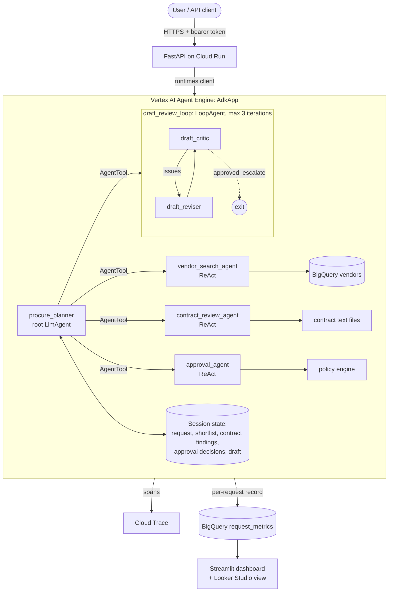

# ProcureAgent

A multi-agent procurement assistant built on Google's Agent Development Kit (ADK 2.x) and Gemini,
deployable to Vertex AI Agent Engine. Describe a purchase need; it finds vendors, reviews their
contracts, checks policy, and returns an approval-ready recommendation.

> *"We need 50 laptops for new hires, budget ₹40L, delivery in 3 weeks"*

## Architecture



**Division of labour.** The model reasons and writes; deterministic code decides.

* **Vendor search**: ranking uses explicit weights (price .40, rating .30, delivery .20, +.05 preferred, +.05 contract on file). The agent explains the shortlist; it cannot reorder it. If fewer than 3 vendors qualify, the tool returns diagnostics (how many would qualify with each constraint dropped) and the agent relaxes one constraint at a time and says which.
* **Contract review**: a clause scanner rates auto-renewal, liability cap, payment terms and termination 1–5 against a documented rubric (`tools/contract_scanner.py`). The agent reads the full text for what a regex cannot see (exclusivity, unilateral price changes) and may move the score by **at most ±1**; `record_contract_findings` clamps anything more.
* **Approval**: `tools/policy_engine.py` returns `approve` / `needs-approval-from: X, Y` / `reject`. The agent reads vendor price, budget and risk **from state and the database, not from arguments**, so it cannot misstate a figure to change the outcome, and is told never to override the decision. `set_recommended_vendor` also **refuses** any vendor that policy rejected or that was never checked, so "never recommend a rejected vendor" is enforced in code, not just the prompt (a live run showed the prompt alone was not enough).
* **Critic loop**: the critic combines `check_draft_facts` (missing fields, decision contradicting the policy engine, vendor ids not on the shortlist, rupee figures that appear nowhere in session data) with LLM judgement, then calls `submit_review`. Empty issues → `escalate` ends the loop; otherwise the reviser rewrites. `max_iterations=3`.

### Policy (data/policy.json)

| Total | Approver | | Hard rejects |
|---|---|---|---|
| ≤ ₹2 L | none (auto-approve) | | total over stated budget |
| ≤ ₹10 L | Department Head | | total over ₹5 Cr single-PO limit |
| ≤ ₹50 L | Finance Director | | vendor rating < 3.5 |
| ≤ ₹5 Cr | CFO | | delivery later than requested |
| | | | missing required certification; below vendor MOQ |
| | | | contract risk score 5/5 |

Escalations: non-preferred vendor above ₹10 L, or a preferred vendor within 10 % of its price → **Procurement Head**; contract risk ≥ 4 or no contract on file → **Legal Counsel**; risk 3 → advisory only.

## Layout

```
agents/          planner, vendor_search, contract_review, approval, critic (+ agent.py: ADK entrypoint `app`)
tools/           vendor repository (BigQuery + local), ranking, contract scanner, policy engine, state + review tools
observability/   TelemetryPlugin, per-request metrics, pricing, sinks, Cloud Trace setup
data/            synthetic vendor generator, BigQuery seeder, 10 contracts, policy.json, pricing.json
dashboard/       Streamlit app, data layer, Looker Studio view SQL
api/             FastAPI wrapper (Cloud Run) with Agent Engine / in-process backends
deploy/          Agent Engine deploy + smoke query, GCP setup, Cloud Run deploy
scripts/         benchmark
tests/           162 tests; ScriptedLlm harness in tests/scripted.py
```

## Setup

```bash
python3 -m venv .venv && .venv/bin/pip install -e ".[dashboard,dev]"
make test                 # 162 tests, no GCP needed
make web                  # adk web . → http://localhost:8000, pick "agents"
```

`adk web` needs Gemini access; without it the UI starts but model calls fail. Copy `.env.example` to
`.env` (gitignored; loaded automatically by `adk web`, the tests, the benchmark and the API) and pick one:

* **AI Studio API key (quickest):** create a key at <https://aistudio.google.com/apikey>, then set
  `GOOGLE_API_KEY=...` and `GOOGLE_GENAI_USE_VERTEXAI=FALSE`. This is the route the live tests were run on.
* **Vertex AI:** set `GOOGLE_CLOUD_PROJECT` / `GOOGLE_CLOUD_LOCATION` and run
  `gcloud auth application-default login`. No key, but it needs a project with billing. Untested here.

With `VENDOR_BACKEND=local` (default) vendors come from the in-memory synthetic set, so BigQuery is optional locally.

**Free-tier keys:** one request makes ~30 model calls (measured: 27–32) and the free tier allows ~15 requests/minute per model, so
unthrottled runs fail with `429 RESOURCE_EXHAUSTED`. Set `PROCURE_MAX_RPM=12` to throttle client-side (a full
request then takes minutes). Models can also return `503` under load; switch with `PROCURE_MODEL`
(e.g. `gemini-3.6-flash`, `gemini-3.5-flash-lite`). `make test-live` and `make benchmark-live` call the real model
and consume quota.

### On Google Cloud

```bash
PROJECT_ID=my-proj ./deploy/setup_gcp.sh          # APIs, service accounts, IAM, API-token secret, BigQuery seed
python -m deploy.agent_engine --project my-proj --location us-central1 --dry-run   # builds, pickles, prints exact config
python -m deploy.agent_engine --project my-proj --location us-central1 \
    --service-account procure-agent@my-proj.iam.gserviceaccount.com                # deploy
python -m deploy.query_agent --project my-proj --resource <printed resource name> "We need 50 laptops, budget ₹40L, delivery in 3 weeks"
PROJECT_ID=my-proj AGENT_ENGINE_RESOURCE_NAME=<resource name> ./deploy/deploy_cloud_run.sh   # public API
```

Things to know before deploying:

* **Python version.** Agent Engine unpickles the `AdkApp`, which requires the same Python minor version locally and remotely. The script defaults to `--python-version 3.12` and refuses to run on a mismatched interpreter. The venv here is 3.14, so build a 3.12 venv for deploys. Dependencies are pinned to your local versions.
* **Naming.** Google has renamed Agent Engine to *Agent Runtime*. The installed SDK exposes it as `agentplatform.Client().runtimes` (old name: `vertexai.Client().agent_engines`); the CLI and resource type still say `agent_engine` / `reasoningEngines`.
* **Secrets.** The API's bearer token is resolved from `PROCURE_API_TOKEN`, then Secret Manager (`procure-api-token`). With no token configured the API refuses every request (503); there is no default token. No keys are in the repo (a test scans for them).
* **Traces.** On Agent Engine `AdkApp(enable_tracing=True)` exports spans; locally set `OTEL_TO_CLOUD_TRACE=true`. ADK 2.x ships spans through `telemetry.googleapis.com`. `setup_gcp.sh` grants `roles/cloudtrace.agent`; I could not confirm that is the only role that endpoint needs, so if traces do not appear check the service account's roles first.

### Public API

```bash
curl -s -H "Authorization: Bearer $TOKEN" -H 'content-type: application/json' \
  -d '{"message":"We need 50 laptops for new hires, budget ₹40L, delivery in 3 weeks"}' $URL/v1/chat
# → {"session_id": "...", "answer": "...", "request_id": "...", "latency_s": ..., "ttft_s": ..., "usage": ...}
curl ... -d '{"message":"swap vendor 2 for a cheaper one","session_id":"<same id>"}' $URL/v1/chat
curl -N ... $URL/v1/chat/stream      # SSE: session, delta*, final, done
curl ... "$URL/v1/sessions/<id>"     # persisted state
```

`usage` (tokens/cost) is returned when the API runs the agents in-process; behind Agent Engine the authoritative per-request
record is written server-side to BigQuery, and the API returns its own end-to-end latency and TTFT.

## Observability

`TelemetryPlugin` runs inside ADK's own spans and records, on every span:

| Span | Attributes |
|---|---|
| `invoke_workflow` (request) | request id, total tokens in/out, cost, TTFT, tokens/sec, model, latency |
| `invoke_agent` | `procure.agent.name`, model, input/output tokens of its own LLM calls, latency |
| `procure.llm_call` (own span per model call) | agent, model, input/output/thinking/cached tokens, latency, TTFT, cost |
| `execute_tool` | `procure.tool.name`, agent, latency, tokens (0 for function tools; an `AgentTool` wraps a whole sub-agent run) |

Per request (`logs/request_metrics.jsonl`, structured log, optionally BigQuery): **total tokens**, **tokens/sec** (output tokens ÷ time spent in the model),
**time to first token** (request start → first chunk of the first model call; a true TTFT only when streaming, which the API stream endpoint and `benchmark --live` use), **cost** (per call from `data/pricing.json`, summed).

Pricing is a dated config, read from Google's AI Studio pricing page on 2026-11-18: `gemini-3.8-flash` (the default model) is
**$0.75 / $3.75 per 1M input/output tokens through 2026-12-31, then $1.50 / $7.50**. The rate switches by date with no code change.
A model missing from the file is priced at the default rate and flagged `pricing_fallback`. Re-check the page before trusting cost figures.

Dashboard: `make dashboard` (cost per request, p50/p95 latency, tokens/sec, KPI tiles, table view). For Looker Studio run `dashboard/looker_view.sql`.
I ran the Streamlit script headlessly against throwaway data to confirm it renders without errors; **I have not looked at the rendered charts in a browser.**

## Demo transcript

From the scripted-model run (the structure is real: the actual agents, tools, policy engine and state; the model's *wording* is templated, so a real Gemini run will read differently).
Tool calls shown are the planner's; each `*_agent` call fans out into the sub-agent's own tool calls.

```text
USER: We need 50 laptops for new hires, budget ₹40L, delivery in 3 weeks
  planner -> parse_inr_amount {"text": "...budget ₹40L..."}              → 4,000,000
  planner -> save_request {"category":"Laptops","quantity":50,"max_delivery_days":21,"budget_inr":4000000.0,...}
  planner -> vendor_search_agent   (search_vendors with contract-on-file preferred → V0003, V0005, V0002)
  planner -> contract_review_agent "Review contracts for V0003 V0005 V0002"
  planner -> approval_agent        "Check policy for V0003 V0005 V0002"
  planner -> set_recommended_vendor {"vendor_id": "V0002"}
  planner -> save_draft → draft_review_loop (critic approved in round 1) → get_final_draft

# Procurement recommendation
Request: 50 x Laptops, budget ₹40,00,000 (₹40.00 L), delivery within 21 days.
Summary: Recommend Bluepeak Systems India Pvt Ltd (V0002) at ₹34,45,000. Policy outcome: needs_approval - approvers: Finance Director.
- Nimbus Devices Ltd (V0003): ₹59,900/unit, total ₹29,95,000, rating 4.1, 12 days, contract risk 5/5, policy: reject - Contract risk score 5/5 is unacceptable
- Orion Digital Supply LLP (V0005): ₹63,500/unit, total ₹31,75,000, rating 4.0, 10 days, contract risk 4/5, needs-approval-from: Finance Director, Procurement Head, Legal Counsel
- Bluepeak Systems India Pvt Ltd (V0002): ₹68,900/unit, total ₹34,45,000, rating 4.4, 18 days, contract risk 2/5, needs-approval-from: Finance Director

USER: swap vendor 2 for a cheaper one            (same session; request + shortlist restored from state)
  planner -> vendor_search_agent  (find_cheaper_alternative(2): V0005 → V0075, saves ₹7,05,000; warns: no contract on file)
  planner -> contract_review_agent / approval_agent  for V0075 only
  → V0075 Kaveri Devices: ₹49,400/unit, total ₹24,70,000, no contract on file, needs-approval-from: Finance Director, Procurement Head, Legal Counsel
```

Note what it shows: the cheapest vendor is rejected on contract risk, and the recommendation is the dearer vendor with a safe contract.

## Cost and latency

**Measured here** (`make benchmark`; scripted models at 0 ms per call, so this is *only* what this repo adds; 30 requests, this machine):

| Metric | Value |
|---|---|
| End-to-end latency, orchestration only, p50 / p95 | 65 ms / 68 ms |
| Model + tool calls per request (median) | 52 |
| `search_vendors` (local backend), p50 / p95 | 0.066 ms / 0.132 ms |
| `scan_contract_clauses`, p50 / p95 | 0.163 ms / 0.173 ms |
| `check_policy`, p50 / p95 | 0.055 ms / 0.059 ms |

**Measured live** (`make benchmark-live`; `gemini-3.5-flash-lite` through a free-tier AI Studio key, `PROCURE_MAX_RPM=12`; 3 requests: the demo, the over-budget case and the 2-laptop case; every request completed with status ok):

| Metric | Mean | Range over the 3 requests |
|---|---|---|
| Model calls / tool calls per request | 30 / 29 | 27–32 / 26–31 |
| Time spent in the model per request | 73 s | 58–89 s |
| Time to first token (request start → first chunk of the first model call, streamed) | 2.4 s | 2.0–3.3 s |
| Tokens/sec (output tokens ÷ time in the model) | 54 | 44–62 |
| Tokens per request (in + out) | 97,846 | 85,087 / 81,429 / 115,372 in; 3,285–4,479 out |
| **Cost per request** | **$0.0335** | $0.030–$0.039 |
| End-to-end latency, p50 / p95 | 143 s / 154 s | 143–156 s |

How to read these:

* **Cost is computed, not billed.** It is the token counts Gemini reported, priced with the `gemini-3.5-flash-lite` rates in `data/pricing.json` ($0.30 in / $2.50 out per 1M, cached input $0.03). On the free tier nothing is charged.
* **End-to-end latency is inflated by the throttle.** The model itself accounted for ~73 s of the ~147 s; the rest is almost entirely `PROCURE_MAX_RPM=12` making calls wait (offline orchestration overhead is ~65 ms, so that is an inference, not a separate measurement). Do not read 143 s as the product's speed.
* **Input tokens dominate**: ~98 k per request across ~30 calls, because each call re-sends the planner's instructions, state and tool schemas. That is where a cheaper design (shorter prompts, context caching) would pay off.
* **One model, three requests.** Not the default model (`gemini-3.8-flash` returned 503 under load) and too few runs for a trustworthy p95.

**Still not measured:** the same numbers for `gemini-3.8-flash` / `gemini-3.6-flash`. `gemini-3.6-flash` on the free tier allows only 20 requests per *day*, and one request needs ~30 calls, so it cannot complete one. Paid-tier billing removes that cap:

```bash
PROCURE_RUN_LIVE=1 python -m scripts.benchmark --live --runs 5     # prints a table, appends to the dashboard's JSONL
```

## Tests

`make test`: 162 passed, 3 skipped (the `live` tests: `make test-live`). The 10 end-to-end scenarios (`tests/test_e2e_scenarios.py`):

| # | Scenario | Expected |
|---|---|---|
| 1 | 50 laptops, ₹40 L, 3 weeks | low-risk vendor recommended; needs Finance Director; critic approves |
| 2 | 50 laptops, **₹10 L** | every option **rejected: exceeds budget**; nothing recommended |
| 3 | 2 laptops, ₹2 L | preferred, safe vendor auto-approved |
| 4 | 400 laptops, ₹3 Cr | escalates to CFO |
| 5 | 1000 laptops, ₹10 Cr | rejected: above ₹5 Cr single-PO limit despite fitting the budget |
| 6 | 50 laptops, 2-day delivery | rejected: misses delivery |
| 7 | ISO 27001 required | every shortlisted vendor holds it |
| 8 | mobile phones (no contracts on file) | needs Legal Counsel; draft says no contract on file |
| 9 | follow-up "swap vendor 2 for a cheaper one" | same session; cheaper vendor swapped in, only it is re-reviewed |
| 10 | planner draft omits approver + has an invented figure | critic sends it back, reviser fixes, approved in round 2 |

Plus: the loop stops after exactly 3 rounds when the reviser never fixes, concurrent requests keep separate metrics, a failing metrics sink never fails a request, auth fails closed.
**The scripted models follow a fixed plan, so these tests prove the plumbing and the invariants, not that Gemini will choose the same steps**; the `live` tests check the invariants against the real model.

## Known limitations

* Live coverage is thin: three tests, each passed once, on the cheapest model. Real-model behaviour can vary between runs; prompts may need tuning against `gemini-3.6-flash` / `gemini-3.8-flash`.
* The throttle (`PROCURE_MAX_RPM`) keeps waiting out of model latency, but a throttled run's end-to-end time includes it, so do not read benchmark latency from a free-tier key as real speed.

* `LoopAgent` is what was asked for and works, but ADK 2.x marks it deprecated in favour of `Workflow` (which cannot yet be a sub-agent of an `LlmAgent`). Expect to migrate.
* The critic loop runs the critic up to 3 times and the reviser up to 3 times; the final revision is not re-reviewed, and the answer then says the review ended with open items.
* The contract scanner's regexes are tuned to the phrasing of the 10 sample contracts. Real contracts need the LLM read (which is why it is in the loop) or a stronger extractor.
* Only the 10 anchor laptop vendors have contracts; other categories exercise the "no contract on file → Legal" path.
* All vendor data is synthetic. `LocalBackend` sessions are in memory; use the Agent Engine backend when Cloud Run runs more than one instance.
* The introductory Gemini rate ends 2026-12-31 (see pricing above).
